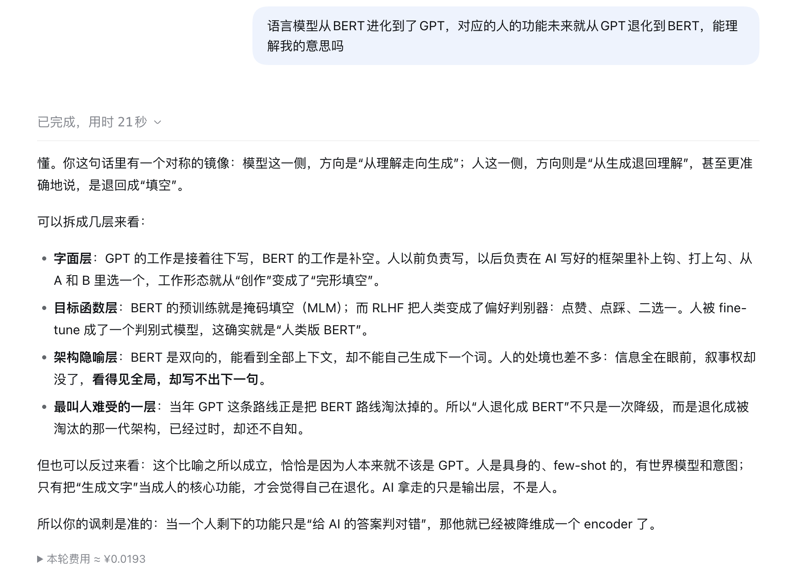

+++
date = '2026-11-08T10:00:00+08:00'
draft = false
title = '看得见全局，写不出下一句'
tags = ['随笔', '大模型']
categories = ['大模型']
+++

（标题是AI想的，哈哈)

结合最近的工作体验，昨晚突然有了上面这个想法：语言模型从BERT到了GPT，人随之从GPT到了BERT。

BERT和GPT的差别简单概括就是目标的差异，一个只是需要理解上下文填空，一个是需要自回归生成。

语言模型进化的过程中从填空升级到了生成，能够完成的任务也丰富了非常多，BERT时代只能比较擅长做分类任务，GPT时代现在已经能做非常多任务了，包括各种理解、生成，特别是生成代码能力，非常强。

随着语言模型的进化，人的能力或者说对人的需求就从GPT到了BERT，以前写代码需要手搓，俗称古法编程，现在人在大部分场景下更多的只需要充当reviewer的角色，就是理解上下文对AI生成的东西进行判断，通常可能是需要修改小部分。随着AI越来越强大，它管理上下文的能力也会越来越强，能力边界也会越来越宽，或许未来人只需要给出比较顶层的决策。

正如上面和AI的对话，这对人来说到底意味着什么，是一种退步吗？还是一种净化？

如果把人的功能就看作是要来生成东西，那必然是退步了，但是人是这样用的吗？实际不然，这一点也是AI点透了我，"这个比喻之所以成立，恰恰是因为人本来就不该是 GPT"，也许不同的阶段人的作用是不同的，随着时代发展人在社会中扮演的角色也会不断演进，比如农耕时代人需要当苦力，进化到机械化后人就只需要操纵，甚至自动化完成；对比到现在这个时代，人之前是需要当办公室牛马，未来可能只需要当决策者，进一步释放人的精力，但未来会是什么样的呢，敬请期待了只能说~
